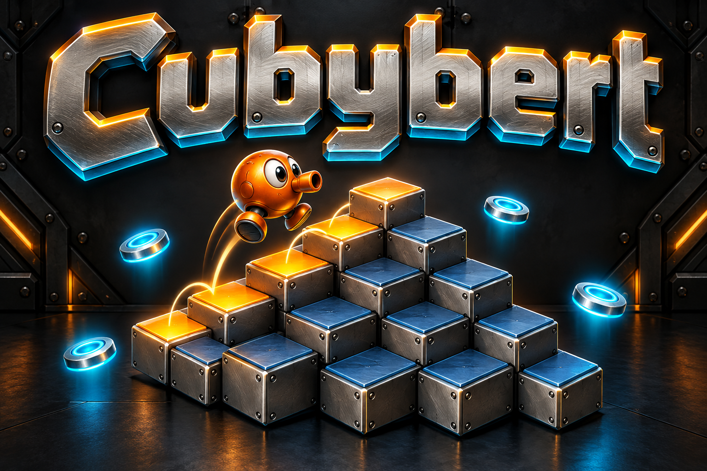

# Cubybert branding



Official name: **Cubybert**.

## Art direction

Brushed metal lettering and an orange metal hopper, with amber cube tops and cyan rescue discs against a gunmetal backdrop.

The existing qbert-clone/documentation/screenshot01.png gameplay capture and qbert-clone/src/renderer.js establish the metallic pyramid, warm amber tops, orange hopper and cyan discs. The screenshot was viewed for visual context only. The final image was generated from a text prompt without supplying, cropping, tracing or compositing a screenshot.

## Asset and usage

- File: `docs/images/game-logo.png`.
- Purpose: README splash illustration and game-directory thumbnail.
- Generation: built-in OpenAI image generation through the existing Codex session. No API key, separately billed API or external image service was used.
- Format: opaque PNG, 1536 by 1024 pixels.
- Keep the complete title visible when displaying or resizing the image. The official name excludes "Multiplayer"; multiplayer capability remains documented separately where applicable.

## Final generation prompt

```text
Use case: logo-brand. Create a completely original landscape 3:2 illustrated game splash from scratch. Exact and only text "Cubybert", spelled C-u-b-y-b-e-r-t. The word is huge across the upper half, custom beveled brushed silver lettering with warm amber top edges and cool cyan rim light, readable at 240px width. Below the word, a whimsical small original polished orange metal hopper with round body, short tubular nose, wide curious eyes and two feet leaps across a floating pyramid of steel cubes. Cube tops change from slate blue to glowing amber along its hopping path. Small cyan rescue discs float beside the pyramid. Industrial arcade style, black gunmetal backdrop, machined bevels, subtle bolts, warm amber and icy cyan lighting. Styled dimensional illustration fits an actual game of hopping on a 28-tile metallic pyramid, orange metal character, silver cube sides, amber tops and cyan discs. Compose new promotional artwork, no screenshot, no HUD or UI frame, no borrowed character or franchise logo, no other text, no watermark, never Multiplayer. Generous safe margins, opaque background.
```
